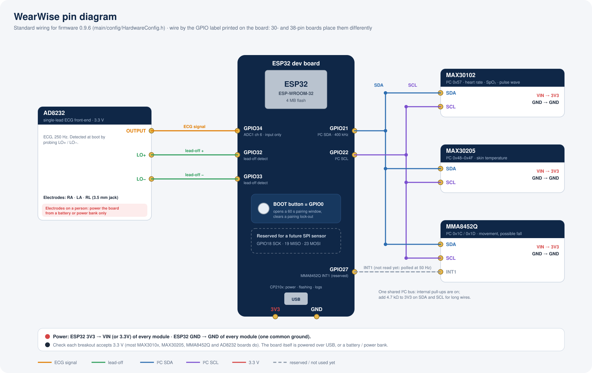

# WearWise

Wearable data, shown plainly. **Your Data, Your Decisions.**

WearWise is a **capstone research prototype** (La Trobe University, CSE3CAP). It has three
parts:

- an ESP32 **sensor patch** that measures heart rate, SpO₂, pulse wave, skin temperature,
  movement and ECG;
- a **phone app** that pairs with the patch over Bluetooth, records sessions on the phone and
  backs them up;
- a **Supabase backend and web dashboard**, where a participant can share chosen signals
  with a researcher.

> WearWise is **not a medical device**. Its readings are prototype sensor measurements and
> are not clinically validated. Fall detection reports a *possible fall* and can be wrong.
> Don't use it for diagnosis or treatment.

This README takes someone who has never seen the project from a fresh clone to a running
system: a local backend, the app on a phone or emulator, the web dashboard, and a patch
streaming live data. Nothing in it depends on the original developer's accounts or machine.

---

## 1. Architecture


(A PNG copy for documents and slides: [`docs/images/architecture.png`](docs/images/architecture.png).)

- **Offline-first.** The phone's encrypted database is the source of truth. Finished
  recordings are uploaded when the backend is reachable.
- **The patch never talks to the backend.** Only the phone does, so changing the backend
  needs no firmware change.
- **Security lives in the database.** Row Level Security decides who can read what.
  Participants share chosen signals with a researcher through one-time share codes, and
  either side can revoke.
- **The backend is picked by configuration**, never by code: a local Supabase for
  development, your own Supabase Cloud project, or a self-hosted Supabase.

More: [docs/architecture.md](docs/architecture.md).

## 2. Repository structure

```
apps/mobile/        Phone app: React Native + Expo SDK 57 (Android, iOS)
apps/dashboard/     Web dashboard: React + Vite (researchers; also Patch setup over USB)
packages/           Shared TypeScript: sensor-protocol, legal, password, design-tokens
firmware/           ESP32 firmware (ESP-IDF 5.4): wearwise-esp32/
supabase/           Backend: config.toml, migrations/, seed.sql + seed/, tests/, sql-tests/, admin/, scripts/
scripts/            use-backend.mjs (switch the apps between local and cloud)
docs/               Documentation (start with docs/knowledge-transfer.md)
design-system/tokens/  Brand design tokens (CSS): the source packages/design-tokens is generated from
tools/audit-apk.ps1    Checks a release APK for leaked secrets or developer paths
```

Design and presentation material (the web mockup, Figma files, slides, trade-show and video
material, brand collateral) is kept by the project team and isn't part of this repository.

## 3. Prerequisites

| For | Install | Tested with |
|---|---|---|
| Everything | **Git**, **Node.js 22 LTS or newer** (includes npm) | Node 24.19, npm 11 |
| Local backend | **Docker Desktop** (or another Docker-compatible runtime), running | Docker Engine 29.8 |
| Local backend | **Supabase CLI**: macOS `brew install supabase/tap/supabase` · Windows `scoop bucket add supabase https://github.com/supabase/scoop-bucket.git` then `scoop install supabase` · Linux: a package from <https://github.com/supabase/cli/releases> | 2.120.0 |
| Android app | **Android Studio** (SDK Platform 36, an emulator image) and **JDK 17** (Android Studio's bundled JDK works), with `ANDROID_HOME` set | SDK 36, JDK 17.0.20 |
| iOS app (macOS only) | **Xcode** with an iOS simulator, **CocoaPods** | Xcode 27.0, CocoaPods 1.17 |
| Firmware from source (optional) | **ESP-IDF v5.4.2** ([docs/firmware.md](docs/firmware.md#install-esp-idf-54-once)) | 5.4.2 |
| Installing firmware without a toolchain | **Chrome or Edge** on a computer, a USB data cable | |
| Hardware (optional) | ESP32 dev board + sensors, see [docs/hardware.md](docs/hardware.md); an Android phone or iPhone with Bluetooth | |

Without hardware, the app's **simulated patch** drives the whole system. Emulators have no
Bluetooth, so they always use it.

> Install the Supabase CLI as a standalone program. Don't use `npx supabase` in this
> repository: `.npmrc` sets `ignore-scripts=true`, which stops the npm package from
> downloading its binary.

## 4. Initial setup

```bash
git clone <repository-url> wearwise
cd wearwise
npm install          # installs apps/* and packages/* (npm workspaces)
```

## 5. Local Supabase

Start Docker Desktop first, then, from the repository root:

```bash
supabase start
```

The first run downloads the Supabase images (several GB, a few minutes). It then creates a
fresh database, **applies every migration** in `supabase/migrations/`, loads the **synthetic
demo data** (`supabase/seed.sql`, `supabase/seed/`) and uploads the demo recording files to
Storage. At the end it prints the local URLs and development keys. Show them again any time
with `supabase status`.

| | |
|---|---|
| API (what the apps use) | `http://127.0.0.1:54321` |
| Studio (browse tables, run SQL) | `http://127.0.0.1:54323` |
| Mailpit (emails the local backend sends) | `http://127.0.0.1:54324` |

**Demo accounts** (local only, every health value simulated):

| Email | Password | Role |
|---|---|---|
| `demo.participant@example.invalid` | `wearwise-demo-only` | participant: has simulated recordings, shares them with the researcher |
| `demo.other@example.invalid` | `wearwise-demo-only` | participant: shares nothing |
| `demo.researcher@example.invalid` | `wearwise-demo-only` | researcher: for the web dashboard |

Useful commands: `supabase db reset` (wipe and rebuild the local database from the
migrations and seed), `supabase stop` (stop; data kept), `supabase stop --no-backup`
(stop and delete the local data). Details: [docs/database.md](docs/database.md).

## 6. Environment configuration

Each app reads its backend from two variables:

| App | Variables | Files (gitignored; templates are `.env.example`) |
|---|---|---|
| Phone app | `EXPO_PUBLIC_SUPABASE_URL`, `EXPO_PUBLIC_SUPABASE_ANON_KEY` | `apps/mobile/.env`, `.env.production` (release builds), `.env.development.local` |
| Dashboard | `VITE_SUPABASE_URL`, `VITE_SUPABASE_ANON_KEY` | `apps/dashboard/.env`, `.env.development.local` |

**Use the local backend** (while `supabase start` is running):

```bash
npm run backend:local
```

This reads the local URL and key from `supabase status` and writes both apps'
`.env.development.local`. Only development builds and the dashboard's dev server read that
file, so release builds are never affected. Check what each app will use with
`npm run backend:status`, and go back with `npm run backend:cloud`.

**Phones and `localhost`.** On a phone, `localhost` means the phone itself. So the script
gives the phone app your computer's **LAN address**, such as `http://192.168.1.20:54321`:

| Device | Use | How |
|---|---|---|
| Physical Android phone or iPhone | your computer's LAN IP (default) | Phone and computer on the **same Wi-Fi**; allow incoming connections on port 54321 in the computer's firewall |
| Android emulator | the LAN IP (default), or `10.0.2.2` (the emulator's alias for your computer) | `npm run backend:local -- --host 10.0.2.2` |
| iOS simulator | the LAN IP (default), or `127.0.0.1` | `npm run backend:local -- --host 127.0.0.1` |
| Android phone on USB, no shared Wi-Fi | `127.0.0.1`, through adb | `adb reverse tcp:54321 tcp:54321`, then `npm run backend:local -- --host 127.0.0.1` |

Finding your LAN IP yourself: macOS `ipconfig getifaddr en0` · Windows `ipconfig` (IPv4
Address of the Wi-Fi adapter) · Linux `hostname -I`. It changes when you join another
network: run `npm run backend:local` again.

Plain `http://` works only in development builds, and only to local or LAN addresses.
Release builds accept only `https://`. Details: [docs/mobile-app.md](docs/mobile-app.md#configuration-which-backend).

## 7. Run the web dashboard

```bash
npm run dev -w dashboard        # http://localhost:5192
```

Sign in as `demo.researcher@example.invalid` / `wearwise-demo-only`. **Participants** lists
*Demo Participant*. Open it to see the simulated sessions, charts, the high-heart-rate alert
and the possible fall, and to download CSV.

## 8. Run the phone app

The app uses native modules, so it runs as its own development build. Expo Go won't work.

```bash
cd apps/mobile
npx expo run:android            # Android: builds, installs and opens it on the emulator or a USB phone
npx expo run:ios                # iOS (macOS): builds and opens it in the simulator
```

The first build takes several minutes. Afterwards, `npx expo start -c` (from
`apps/mobile`) restarts only the JavaScript bundler. Run it with `-c` after any
`backend:local` / `backend:cloud` change, because the values are bundled in.

For a physical Android phone: enable *Developer options → USB debugging*, connect it, and
check `adb devices` lists it. If more than one device is connected, `npx expo run:android`
asks which one to use, or name it: `npx expo run:android --device <name>` (an emulator's AVD
name, e.g. `Pixel_8_API_36`, or the phone's model).

> Every development build on your network loads its JavaScript from the Metro bundler running
> on this computer, port 8081, including other phones that once ran a development build from
> it. Switching `backend:local` / `backend:cloud` and restarting Metro switches all of them. For a physical iPhone: `npx expo run:ios --device`, with your Apple
team chosen in Xcode (see [docs/deployment.md](docs/deployment.md#ios-macos-with-xcode)).

## 9. Start from zero: the full runbook

Each step says what you should see.

1. **Clone and install:** sections 4 and 3. `npm install` finishes without errors.
2. **Docker:** Docker Desktop is running (`docker info` prints a server version).
3. **Supabase CLI:** `supabase --version` prints 2.120 or newer.
4. **Start the backend:** `supabase start`. It ends by listing the local URLs and keys, including
   the API URL `http://127.0.0.1:54321` (`supabase status` shows them again).
5. **Migrations:** applied by step 4 ("Applying migration …" for all 11).
   `supabase db reset` re-applies them on a clean database at any time.
6. **Demo data:** loaded by step 4. Studio → Table Editor → `recorded_sessions` shows 3
   simulated sessions.
7. **Configure the apps:** `npm run backend:local`, then `npm run backend:status` shows
   `http://<LAN IP>:54321` for the phone and `http://127.0.0.1:54321` for the dashboard.
8. **Dashboard:** section 7. Sign in as the demo researcher and see the shared sessions.
9. **Phone app:** section 8. The sign-in screen appears with no "backend not configured"
   message.
10. **Create a test account:** **Create account** in the app. Any address (for example
    `you+test1@example.com`), a password of 10+ characters, tick the boxes. Local email
    confirmation is off, so you're signed straight in. Or sign in as the demo participant:
    its recordings are restored into **History**.
11. **Patch firmware:** either the dashboard's **Patch setup** page (Chrome or Edge,
    researcher account, USB cable: *Set up* installs firmware and writes the PIN; print it
    on the patch), or build and flash from source ([docs/firmware.md](docs/firmware.md)).
12. **Sensors:** wire them as in [docs/hardware.md](docs/hardware.md) (I²C SDA 21, SCL 22;
    AD8232 34/32/33). The serial log at boot lists every sensor found.
13. **Pair over Bluetooth:** physical phone only. **Devices → Pair a Device**, pick
    `WearWise-XXXX`, type the label PIN when the phone asks. No hardware? **Use
    Simulation** on the Devices tab.
14. **Live data:** Home shows the signals the patch reports, live. Sensors the patch lacks
    say so.
15. **Record and view history:** start a recording on Home, stop it, open it in **History**.
16. **Offline:** turn on airplane mode, or stop the backend with `supabase stop`. Record a
    session: it records normally and waits as "not backed up".
17. **Sync:** turn the network back on, or run `supabase start`, then bring the app to the
    foreground. The session uploads within a minute (**Profile → Privacy & access** shows the
    backup status and has **Back up now**). Check it in Studio (`recorded_sessions`) or in the
    dashboard once shared.
18. **Share with a researcher:** in the app, **Profile → Privacy & access → Share my data**
    creates a code. In the dashboard, the researcher uses **Participants → Add participant**
    and enters it. The participant's uploaded sessions appear there.

## 10. ESP32 firmware and hardware

- Install firmware **without a toolchain**: dashboard → **Patch setup** (Chrome or Edge,
  staff account). It installs the bundled firmware 0.9.6 and gives the patch its label PIN.
- **From source:** ESP-IDF 5.4.2, then `cd firmware/wearwise-esp32 && idf.py set-target esp32
  && idf.py build && idf.py -p <PORT> flash monitor`. See [docs/firmware.md](docs/firmware.md).
- **Wiring** (ESP-WROOM-32): I²C SDA **GPIO21**, SCL **GPIO22** (MAX30102, MAX30205,
  MMA8452Q); AD8232 output **GPIO34**, LO+ **GPIO32**, LO− **GPIO33**; MMA8452Q INT1
  **GPIO27** (reserved); SPI 18/19/23 reserved. Full table and safety notes:
  [docs/hardware.md](docs/hardware.md).


- Bluetooth interface and packet format: [docs/ble-protocol.md](docs/ble-protocol.md).

## 11. Testing

| What | Command (from the repository root) |
|---|---|
| Phone app: types and unit tests (incl. `packages/sensor-protocol`) | `npm run typecheck -w mobile && npm test -w mobile` |
| Dashboard: types and unit tests (incl. `packages/legal`) | `npm run typecheck -w dashboard && npm test -w dashboard` |
| Database: RLS and security suites on the local stack (**resets the local DB**) | `bash supabase/sql-tests/run-on-local-stack.sh` |
| Database: pgTAP only | `supabase test db` |
| Backend through its public API (sync, Storage, two-user isolation) | see [docs/database.md](docs/database.md#tests) |
| Firmware: host test of the PIN record | see [docs/firmware.md](docs/firmware.md#tests) |
| Hardware procedures | `docs/testing/hardware-test-matrix.md` |

## 12. Building for release

- **Android:** `.env.production` with an **https** backend, your own signing key
  (`node apps/mobile/scripts/create-release-signing.cjs`), then
  `NODE_ENV=production ./gradlew assembleRelease` in `apps/mobile/android`.
- **iOS:** `.env.production`, then `npx expo prebuild --platform ios`, open
  `apps/mobile/ios/WearWise.xcworkspace` in Xcode, choose your team, Archive.
- **Dashboard:** `npm run deploy-config -w dashboard` (security headers for your backend),
  then `npm run build -w dashboard` and host `apps/dashboard/dist/`.

Step by step: [docs/deployment.md](docs/deployment.md).

## 13. Switching to Supabase Cloud (or self-hosted)

1. Create a project under your organisation's Supabase account.
2. `supabase login`, then `supabase link --project-ref <ref>`, then `supabase db push`
   (applies the same migrations; **don't** push the seed).
3. Set Auth, SMTP and Realtime settings in its dashboard.
4. Put its URL and publishable key in `apps/mobile/.env` and `.env.production` and
   `apps/dashboard/.env`, then run `npm run backend:cloud`.

Self-hosted Supabase works the same way over HTTPS. Full guide: [docs/deployment.md](docs/deployment.md).

## 14. Security notes

- **No secrets in the repository.** The apps need only a project URL and its publishable key.
  Service keys, database passwords, access tokens and signing keys stay with their owner.
  See [docs/security.md](docs/security.md) for the full list and who creates each one.
- Real `.env` files, keystores and Apple signing files are gitignored. Never commit them.
- The demo accounts and the local stack's keys are for local development only.
- The local stack is reachable from your network while running. Use a trusted network.
- Security practices are informed by relevant guidance (OWASP MASVS and Top 10, Supabase
  guidance). Nothing is certified.

## 15. Known limitations

- Research prototype: measurements are not clinically validated. SpO₂ uses an uncalibrated
  formula, and some modules read low or show double heart rate before settling.
- Possible-fall detection is a simple threshold heuristic. Nothing outside WearWise is
  alerted (no SMS or emergency call).
- Emulators and simulators have no Bluetooth, so real-patch tests need a physical phone.
- The iOS app has had less real-device testing than Android.
- No over-the-air firmware updates (USB only), no MFA for the dashboard, no data retention
  policy in the app.

More in [docs/knowledge-transfer.md](docs/knowledge-transfer.md#s-known-limitations).

## 16. Troubleshooting

See [docs/troubleshooting.md](docs/troubleshooting.md). The usual suspects:

- **"Backend not configured" in the app:** run `npm run backend:local` (or fill in `.env`),
  then restart Metro with `npx expo start -c`.
- **Phone can't reach the local backend:** same Wi-Fi? Firewall allows port 54321? The IP
  changed? Run `npm run backend:local` again.
- **`supabase start` fails:** is Docker running? Are ports 54321–54327 free?
- **Pairing refused:** remove the old WearWise entry in the phone's Bluetooth settings,
  press BOOT on the patch, and type the label PIN within a minute.

## 17. Future development

Calibrated SpO₂ against a reference oximeter, emergency-contact notification for falls,
interrupt-driven motion (GPIO27), more sensors through the driver interface
([docs/firmware.md](docs/firmware.md#adding-a-new-sensor)), MFA for staff accounts,
retention controls, over-the-air firmware updates, and an independent security review. See
[docs/knowledge-transfer.md](docs/knowledge-transfer.md#t-future-improvements).

## Documentation map

| Document | For |
|---|---|
| [docs/knowledge-transfer.md](docs/knowledge-transfer.md) | **Start here**: the handover guide |
| [docs/architecture.md](docs/architecture.md) | How the pieces fit, key decisions |
| [docs/mobile-app.md](docs/mobile-app.md) | Phone app internals |
| [docs/database.md](docs/database.md) | Schema, RLS, migrations, seed, tests |
| [docs/firmware.md](docs/firmware.md) · [docs/hardware.md](docs/hardware.md) · [docs/ble-protocol.md](docs/ble-protocol.md) | Patch |
| [docs/deployment.md](docs/deployment.md) | Cloud, self-hosted, release builds |
| [docs/security.md](docs/security.md) | Controls, secrets, responsibilities |
| [docs/troubleshooting.md](docs/troubleshooting.md) | When something doesn't work |
| `apps/dashboard/README.md` | Dashboard features, Patch setup |
| `docs/architecture/`, `docs/database/`, `docs/testing/`, `docs/security/` | Design notes, schema history, test reports, audits |
