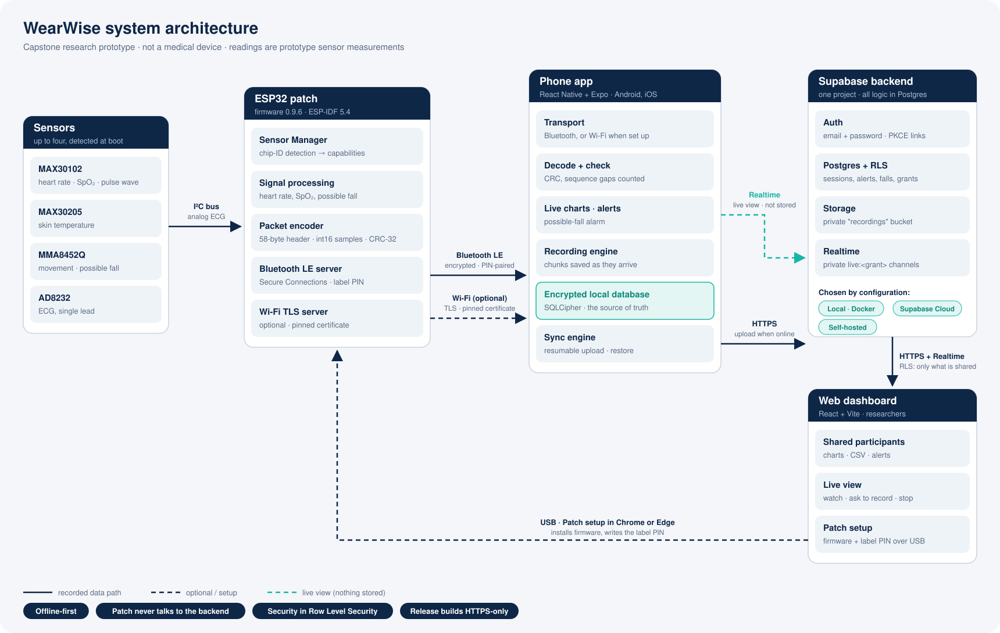

# WearWise architecture

WearWise is a **capstone research prototype** for collecting wearable sensor data with the
participant in control: a sensor patch, a phone app, and a backend that lets a participant
share chosen signals with a researcher. It reports prototype sensor measurements only. It is
not a medical device, its measurements are not clinically validated, and fall detection
reports a *possible fall* that can be wrong.



## The pieces

| Piece | Path | Technology | Role |
|---|---|---|---|
| Sensor patch firmware | `firmware/wearwise-esp32/` | ESP32, ESP-IDF 5.4, C | Detects sensors, streams packets over Bluetooth LE (and optionally Wi-Fi to the phone) |
| Participant app | `apps/mobile/` | React Native 0.86, Expo SDK 57, TypeScript | Pairs with the patch, shows live data, records sessions into an encrypted local database, uploads them, manages sharing and live view |
| Web dashboard | `apps/dashboard/` | React 19, Vite, TypeScript | For researchers and clinicians: shared participants, recordings, alerts, live view, Patch setup (installs firmware over USB). Participants can also sign in to see their own data |
| Backend | `supabase/` | Supabase (Postgres 17, Auth, Storage, Realtime, PostgREST) | Accounts, the cloud copy of recordings, sharing, alerts, live-view relay |
| Shared packages | `packages/` | TypeScript (source, no build step) | `sensor-protocol` (packet codec, the contract with the firmware), `legal` (terms and their version), `password` (strength rules), `design-tokens` |

`design-system/tokens/` holds the brand design tokens (CSS) that `packages/design-tokens` is
generated from. Design and presentation material (the interactive web mockup, Figma files,
slides, trade-show and video material, brand collateral) is kept by the project team and isn't
part of this repository; nothing here depends on it.

## Main data path

```
 Wearable sensors (MAX30102, MAX30205, MMA8452Q, AD8232)
        │  I²C / analog
        ▼
 ESP32 patch firmware ── detects sensors → capability list, encodes packets (CRC-32)
        │  Bluetooth LE: encrypted, PIN-paired (optional: pinned-TLS WebSocket on the same Wi-Fi)
        ▼
 WearWise phone app ── decodes + checks every packet, live charts, alerts, possible-fall alarm
        │  writes every chunk as it arrives
        ▼
 Encrypted local database on the phone (SQLCipher) ── the source of truth; works fully offline
        │  when a recording is finished and the backend is reachable (resumable, idempotent)
        ▼
 Supabase ── rows in Postgres (RLS), channel files in the private "recordings" bucket
        │  only what the participant chose to share, while the grant is live
        ▼
 Web dashboard (researcher) ── charts, CSV export, alerts; live view over Realtime broadcast
```

Live view takes a separate path that stores nothing. While the participant has live view
on, the phone broadcasts readings on a private Realtime channel, `live:<grant id>`. Only
the researcher holding that grant can join it.

## Key design decisions

| Decision | Why | Where |
|---|---|---|
| **Offline-first; the phone's encrypted database is the source of truth.** The cloud is an upload-only mirror (plus a one-time restore onto a new phone) | Recordings must survive no signal, a dead backend or a lost connection mid-session | `docs/architecture/offline-first.md`, `apps/mobile/src/domain/sync/sync-engine.ts` |
| **The patch never talks to the backend** | Firmware stays simple; no backend credentials or hostnames on a device that can be lost; moving the backend needs no firmware change | [firmware.md](firmware.md) |
| **One binary packet format, shared by firmware and app, with a fixture both test against** | A protocol drift fails tests, not studies | [ble-protocol.md](ble-protocol.md), `packages/sensor-protocol` |
| **Capabilities are discovered, never assumed** | One firmware for any subset of sensors; the app shows only what the patch has | `SensorManager.c`, CAPS characteristic |
| **Security in the database (Row Level Security), not in the apps** | The anon key ships in every app; every privilege decision must hold even against a modified client | [database.md](database.md), [security.md](security.md) |
| **Sharing is opt-in, scoped and revocable**: one-time share codes → access grants per signal | Participants decide who sees what, and either side can end it | migration 5, `docs/operations/researcher-access.md` |
| **Roles are server-controlled** (participant / researcher / clinician) | Nobody can promote themselves | migrations 1, 4, 9 |
| **The backend is chosen by configuration only** (`EXPO_PUBLIC_SUPABASE_*`, `VITE_SUPABASE_*`) | Local, owner's cloud and self-hosted deployments run the same code | [deployment.md](deployment.md) |
| **Release builds are HTTPS-only; plain http is allowed only in development builds and only to local/LAN hosts** | Local development must not weaken production | `apps/mobile/src/data/remote/public-config.ts`, `scripts/check-release-config.cjs` |
| **No Edge Functions, no server code of our own** | Fewer secrets and moving parts: Postgres functions (RPCs) and policies do the server work | `supabase/migrations/` |

## Environments

```
 A. Local development / handover      B. Hosted                   C. Self-hosted / institutional
 apps ─▶ http://<LAN-IP>:54321          apps ─▶ https://<ref>.supabase.co   apps ─▶ https://supabase.<org>
        local Supabase in Docker               owner's Supabase Cloud              organisation-run Supabase
        (supabase start)                       (supabase db push)                  (same migrations)
```

The same migrations build all three. See [deployment.md](deployment.md).

## Where to read next

- [mobile-app.md](mobile-app.md): app structure, BLE, storage, sync.
- [database.md](database.md): tables, RLS, RPCs, Storage, Realtime, migrations, seed.
- [firmware.md](firmware.md), [hardware.md](hardware.md), [ble-protocol.md](ble-protocol.md).
- [security.md](security.md), [deployment.md](deployment.md), [troubleshooting.md](troubleshooting.md).
- [knowledge-transfer.md](knowledge-transfer.md): the handover guide.
- Deeper design notes: `docs/architecture/` (offline-first, live view and alerts, mobile
  architecture) and `docs/database/cloud-schema.md` (the original schema notes, with history).
